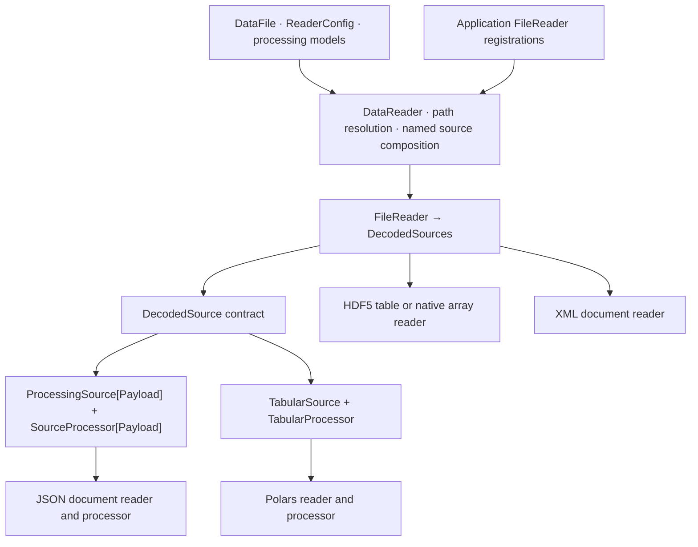
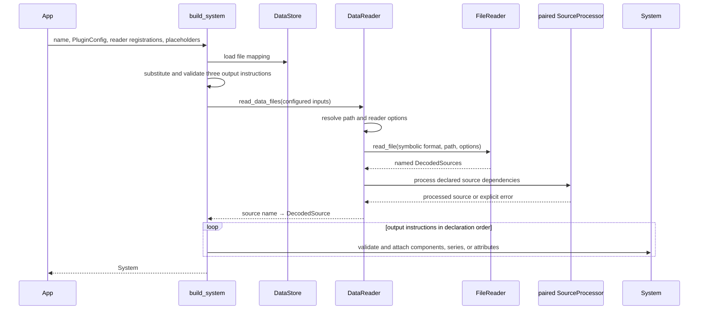

r2x-core separates input configuration, source decoding, system construction,
translation from one `System` to another, and serialization. Core includes
common readers and processors. Applications provide their models and
configuration, and register readers for uncommon formats.

## Read and process sources

`FileReader` decodes a file into one or more named sources. `DecodedSource`
provides field, row, and value access, along with a processing method.
`ProcessingSource[Payload]` pairs a payload with a `SourceProcessor[Payload]`.
`TabularProcessor` adds native table access. Each paired implementation handles
its own payload. `DataReader` does not select processing by file format.

CSV, TSV, Parquet, HDF5 tables, JSON, and XML use symbolic names inferred from
common extensions or set with `ReaderConfig.format`. The selected reader checks
its own options. JSON configuration does not import code. A custom source can
implement `DecodedSource` directly. A vendor payload can use its own type rather
than an arbitrary object inside a wrapper.

## Reading and constructing a System

`DataReader.read_data_files` reads files and combines named sources. Its decode
cache lasts for one call and uses the resolved path, format, and options as its
key. Core resolves named dependencies, including joins across compatible
sources. With no requested operations, sources pass through unchanged.
Unsupported operations fail explicitly.

`build_system` is the standard configured construction operation. Exactly three
tagged instruction kinds construct components, attach time series, and attach
supplemental attributes. References and owners use public component lookup by
(type, name). Each output is validated before attachment. Instructions execute
in declaration order and fail fast. Earlier attachments are not rolled back if
a later instruction fails.

`DataStore` manages mapping configuration and upgrade handlers. It does not
read files. If a required input is missing, the configured handler runs and the
reader retries once. Loading a saved system with `System.from_json` is separate
from reading input files.

## System translation remains separate

Reading files is separate from translating one system to another with rules.
Translation still uses dependency ordering and rule filters. It can create
components and supplemental outputs, preserve source data, and transfer or
replace time series.

## Plugins and units

`PluginContext` holds configuration, optional store, working System, and
translation state. `Plugin.run` invokes implemented hooks in order. A returned
`Err` stops the run, but earlier state changes and file writes are not
transactional or automatically rolled back.

Pydantic checks unit annotations against the model's fields. A structured unit
value tells r2x-core which physical unit the input uses. A number for a relative
field is already normalized. See the [unit reference](/r2x-core/references/units/)
for conversion details.

## Module inventory

| Module | Responsibility |
| --- | --- |
| `datafile`, `models`, `types` | Input, processing, time axis, and output instruction models |
| `file_reader` | Decoded source and processor contracts |
| `reader` | Symbolic reader selection, runtime path resolution, source reuse and composition |
| `polars_adapter` | Polars table reader, processor, expressions, and ordered operations |
| `json_adapter` | JSON document reader and processor |
| `h5py_adapter`, `xml_adapter` | Native HDF5 array/table and XML document readers |
| `ingestion` | `build_system` and the three output handlers |
| `store` | File mapping configuration and upgrade coordination |
| `tabular_backend` | Ordered mapping protocol and runner |
| `rules`, `rules_executor` | Separate System translation workflow |
| `time_series` | Time series metadata transfer and association replacement |
| `plugin_base`, `plugin_context` | Plugin hooks and shared execution context |
| `system`, `units`, `provenance` | Infrasys System extensions, units, and provenance |

The root API uses lazy imports, so importing configuration models does not load
infrasys or Polars. APIs for reading sources and building systems load their
required implementations when used.
