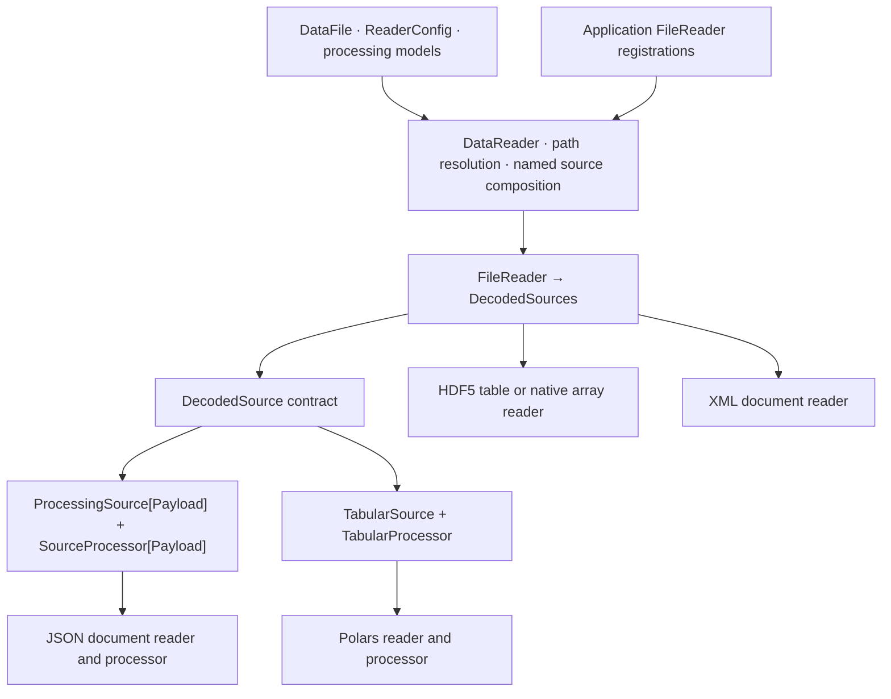
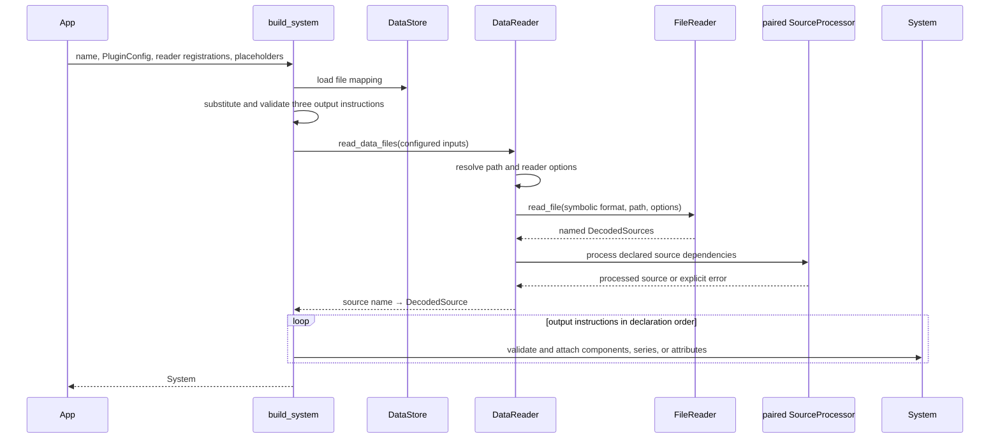
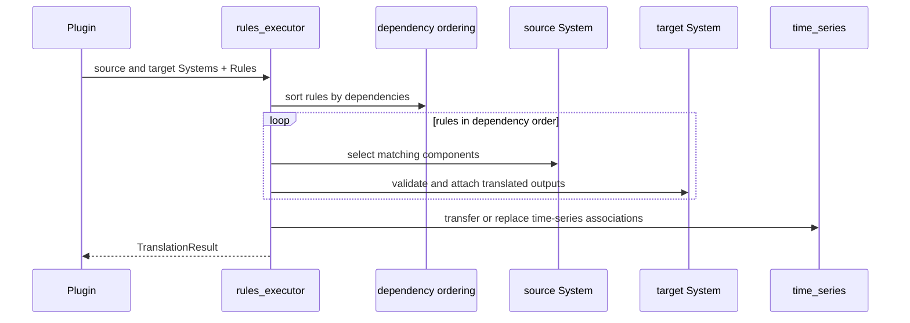

r2x-core separates input configuration, typed source decoding, system
construction, System-to-System translation, and serialization. Common readers
and processors are built in. Applications register only readers for uncommon
formats and provide their models and configuration.

## Typed source and processing seam

`FileReader` selects and decodes a physical format into one or more named
sources. `DecodedSource` provides field, row, and value access plus its
processing method. `ProcessingSource[Payload]` couples a payload to a
`SourceProcessor[Payload]`; `TabularProcessor` adds native table access.
Representation-specific processing lives in the paired implementation, not in
a format-level dispatcher in `DataReader`.

CSV, TSV, Parquet, HDF5 tables, JSON, and XML are selected by symbolic names
inferred from common extensions or set with `ReaderConfig.format`. Reader
options are validated by the selected reader. JSON does not import code from
configuration. A custom source may implement `DecodedSource` directly, while
vendor-specific payloads remain explicit types rather than arbitrary objects
inside a built-in wrapper.

## Reading and constructing a System

`DataReader.read_data_files` is the public source-loading and composition seam.
Its decode cache is local to one call and keyed by canonical path, symbolic
format, and options. Named dependencies, including joins across separately
decoded compatible sources, are resolved in core. No requested operations mean
pass-through. Requested unsupported operations fail explicitly.

`build_system` is the standard configured construction operation. Exactly three
tagged instruction kinds construct components, attach time series, and attach
supplemental attributes. References and owners use public component lookup by
(type, name). Each output is validated before attachment. Instructions execute
in declaration order and fail fast. Earlier attachments are not rolled back if
a later instruction fails.

`DataStore` manages mapping configuration and upgrade handlers; it does not
read files. A configured handler runs on the canonical build/read path when a
required input is missing, followed by one retry. `System.from_json` and
serialized-system loading remain separate from file ingestion.

## System translation remains separate

File ingestion does not replace or wrap the rule-based System translation
workflow. Translation retains dependency ordering, rule filters, component and
supplemental outputs, source preservation, and time-series transfer and
replacement.

## Plugin and unit boundaries

`PluginContext` holds configuration, optional store, working System, and
translation state. `Plugin.run` invokes implemented hooks in order. A returned
`Err` stops the run, but earlier state changes and file writes are not
transactional or automatically rolled back.

Unit annotations are resolved through Pydantic model schemas and the owning
model's fields. Structured unit values distinguish natural-unit input from
already normalized internal values. See the [unit reference](/r2x-core/references/units/)
for conversion behavior.

## Module inventory

| Module | Responsibility |
| --- | --- |
| `datafile`, `models`, `types` | Strict input, processing, time-axis, and output-instruction models |
| `file_reader` | Typed decoded-source and paired processor contracts |
| `reader` | Symbolic reader selection, runtime path resolution, source reuse and composition |
| `polars_adapter` | Polars table reader, processor, expressions, and ordered operations |
| `json_adapter` | JSON document reader and processor |
| `h5_adapter`, `xml_adapter` | Native HDF5 array/table and XML document readers |
| `ingestion` | `build_system` and the three output handlers |
| `store` | File-mapping configuration and upgrade coordination |
| `tabular_backend` | Ordered mapping-step protocol and runner |
| `rules`, `rules_executor` | Separate System translation workflow |
| `time_series` | Time-series metadata transfer and association replacement |
| `plugin_base`, `plugin_context` | Plugin hooks and shared execution context |
| `system`, `units`, `provenance` | Infrasys System extensions, units, and provenance |

The root API uses lazy imports so importing configuration models does not load
infrasys or Polars. The source-loading and construction APIs load their required
implementations when used.
