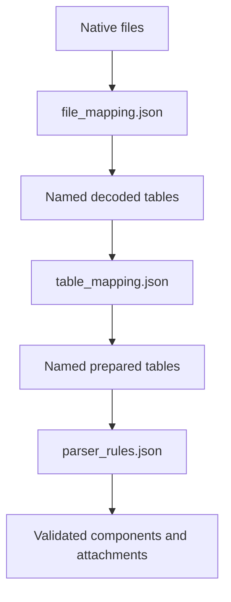

An application's input files rarely have the same shape as its component models.
A capacity file may contain several years in columns. A price file may identify
technologies rather than components. A time series may need a complete calendar
even when its source observations cover only part of that calendar.

Table assembly is the boundary for those transformations. It gives app
maintainers named, inspectable tables between file reading and component
construction, without requiring each application to maintain its own row loops.

## Availability

Core supports typed row and concat constructors, bindings for whole values, and
final `columns` projection through `r2x_core.assemble_tables` and the optional
`build_system(..., table_mapping_path=...)` path. An optional input with a schema
retains whether it was absent or present with no rows. Table mapping `operation`
records are separate from the supported [steps for processing files](/r2x-core/how-tos/process-file-data/).

For a guided example, follow [Assemble hourly reserve requirements](/r2x-core/tutorials/assemble-reserve-requirements/).
To adapt a mapping to your own data, use [Adapt table mappings](/r2x-core/how-tos/adapt-table-mappings/).
Look up exact fields in the [table mapping reference](/r2x-core/references/table-mapping/).

## Give each file one responsibility

| File | Responsibility |
| --- | --- |
| `file_mapping.json` | Describe files as supplied, including columns, input filters, and column mappings. Produce named decoded tables. |
| `table_mapping.json` | Combine, reshape, filter, calculate, and aggregate tables into the rows the parser needs. |
| `parser_rules.json` | Select application models, construct components, resolve references, and attach time series or supplemental attributes. |

Application configuration supplies choices such as model years, weather years,
products, and coefficients. A table mapping consumes those choices through typed
placeholders. It does not provide a second configuration system.

This separation keeps input format changes apart from model changes.
Renaming an input column belongs at the file boundary. Combining capacity and
price tables belongs in assembly. Changing the component class or attachment
owner belongs in parser rules.

## A table name identifies a useful intermediate result

A named table gives the next operation a clear starting point. For example,
`solar_capacity` answers how much installed capacity exists in each region and
year. `active_solar_hours` answers which hours meet an activity condition. Neither
requires an inline table definition inside the final calculation.

The table's name, source, ordered operations, and output columns describe how to
obtain its result. An operation's position is meaningful. JSON member order is
not. A final column map defines the output boundary after the operations finish.

A name describes a logical result, not a promise that a backend stores another
complete copy in memory. Keep a useful intermediate table named even when only
one later table consumes it. Readability should not depend on hiding its work
inside that consumer.

## Normalize rows when the calculation is shared

Suppose several categories contribute to the same result. Give each category the
same quantity columns, then keep its coefficient in a separate factor table:

| kind | quantity_mw |
| --- | ---: |
| load | 10.0 |
| wind | 0.0 |
| solar | 500.0 |

| product | kind | fraction |
| --- | --- | ---: |
| SPINNING | load | 0.3 |
| SPINNING | wind | 0.1 |
| SPINNING | solar | 0.2 |

Join on `kind`, multiply quantity by fraction, and sum the contributions. The
result is 103 MW. Adding another product supplies more factor rows instead of
another arithmetic branch. Adding another category changes its preparation and
the factor mapping, not the common multiplication.

The same structure works for energy multiplied by a price or activity multiplied
by an emissions rate. Column names, units, categories, and output keys belong to
the application. `kind` is an ordinary string column, not a core registry of
ReEDS technologies.

Normalization is useful when categories share a row shape and a meaningful
calculation. It is not a reason to put unrelated component attributes into one
value column. Quantities being summed must have compatible units. The mapping
does not infer units from a column name or convert them automatically.

## Match on every dimension that changes the value

Keys express the conditions under which two rows belong together. A coefficient
that depends only on category needs a category key. A price that changes by
region and year needs both keys.

Adding a year column to a table does not make a join use it. The join must list
that column in `on`. Omitting it can match a quantity to several years of prices
and multiply the result. Duplicate keys on the right also produce multiple
matches, not an arbitrary first match.

Grouping keys are the output identity of an aggregate. Keep product, year,
region, and time in the group whenever their results must remain distinct.
Remove a key only when combining those values is the intended calculation.

## Missing observations and zero are different choices

A missing observation does not create an output row. When the parser needs every
owner, requested year, and hour, construct that grid explicitly and left join the
observations onto it.

Use `fill_null` only when the application defines a missing value as zero. A
missing reserve contribution can mean zero after the complete grid is built. A
missing market price generally does not mean free energy. Keeping that null
visible is different from deliberately supplying a default.

An absent optional source, a table with no rows, a null value, and a malformed
source are different states. Optional availability does not turn invalid input
into an empty table. These distinctions keep a fill policy from hiding a read
or configuration error.

## Keep validation at the appropriate boundary

A transformation still needs valid column names and compatible types. Rejecting
an unknown join column is not a business rule. It prevents the requested join. A `rows` constructor likewise needs a declared schema
to construct typed values, including an empty table.

Table assembly does not create a Pydantic model for each row or decide which
values an application's components accept. Configuration validates its own
parameters. Parser rules construct and validate application models and enforce
attachment contracts.

The table sent to the parser is an agreement between its maintainers.
Preparation can change while its field names, types, keys, units, and ordering
remain stable. The parser does not need to know whether a requirement came from
three source tables or four.

For the existing construction and serialization boundaries, see
[workflow boundaries](/r2x-core/explanations/workflow-boundaries/).
