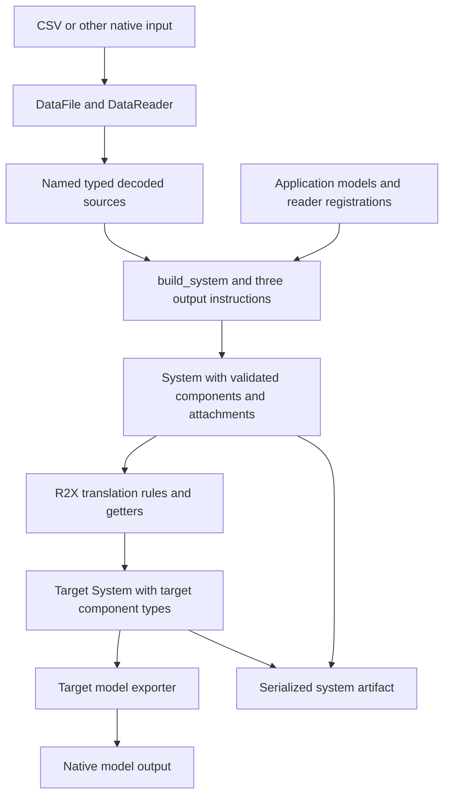

The [CSV tutorial](/r2x-core/tutorials/getting-started/) crosses three boundaries: source files become typed components, hooks change a system, and serialization makes that result loadable by another process.
Keeping those boundaries visible makes it easier to locate a failure and choose a useful validation check.

## Source decoding is separate from configured construction

`DataFile` declares a path, symbolic reader selection, options, and processing.
`DataReader.read_data_files()` resolves inputs and returns named typed sources.
`build_system()` runs the configured component, time series, and supplemental
attribute instructions using application models and public infrasys APIs.
Applications supply those models, reader registrations for uncommon formats,
and configuration. They do not need separate loops to build or attach
components.

Translating one system to another is a separate operation. It uses rules,
dependency ordering, supplemental outputs, and the existing time series
transfer and replacement behavior.

[Model packages](https://natlabrockies.github.io/R2X/explanation/architecture/) such as r2x-reeds, r2x-plexos, and r2x-sienna supply components, parsers, and exporters for their formats.
[R2X](https://github.com/NatLabRockies/R2X) supplies interoperability mappings between them.
Core supplies the shared system, configuration, rule, and lifecycle contracts.

## The context is shared state, not a transaction

`PluginContext` holds configuration, an optional store, a working system, and the source and target systems used in translation.
A build hook's `Ok(system)` sets `context.system`. A translation hook's result sets `context.target_system`.
Transform hooks can mutate existing components.
A failure stops the lifecycle but does not undo earlier mutations or file writes, and `on_cleanup` is not guaranteed after an error.
Use a fresh context for independent runs and explicit copies/backups when rollback is a requirement.

This is why the tutorial filters rows before creating components, checks the result in memory, and then loads it again in a separate check.
A successful read proves the input syntax. It does not prove the component schema, transformation, or artifact portability.

## An artifact is a bundle, not only JSON

`System.to_json(path)` persists component metadata and companion storage.
A component records its Python module and class, so the receiving environment needs compatible model packages.
Moving JSON without storage, or loading it in an environment without those classes, can fail despite valid JSON syntax.
See [serialization contracts](/r2x-core/references/data-workflow/#system-serialization) and [CLI system inspection](https://github.com/NatLabRockies/r2x-cli/blob/main/docs/cli-reference.md#read).

A native model export has a different consumer and schema.
A Sienna exporter writes native Sienna/PowerSystems data. `System.from_json()` loads an infrasys system artifact.
Choose the parser or loader that matches the artifact you actually saved.

## When to add the CLI

Direct Python execution is useful while developing and testing a parser or transformation in one project environment.
[r2x-cli](https://github.com/NatLabRockies/r2x-cli) finds installed plugins, manages their Python environment, runs named pipelines, and passes results between commands.
It does not replace model validation or supply missing input datasets.
Once the plugin's Python contract works, follow the CLI's [Getting Started guide](https://github.com/NatLabRockies/r2x-cli/blob/main/docs/getting-started.md#validate-and-run-a-pipeline) to run it in a named pipeline.
