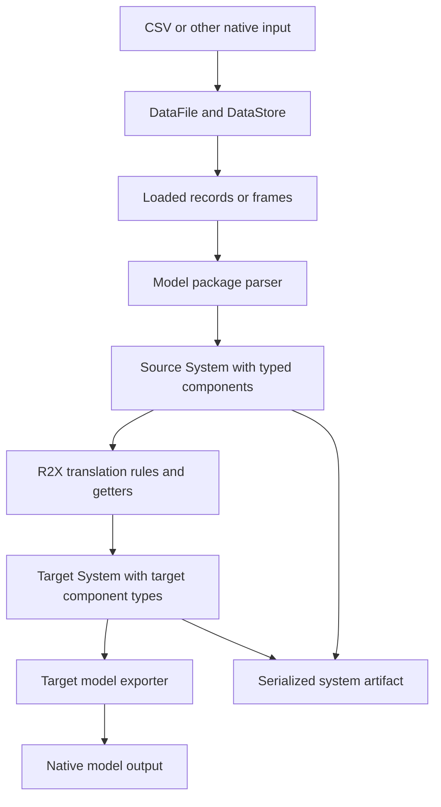

The [CSV tutorial](/r2x-core/tutorials/getting-started/) crosses three boundaries: source files become typed components, hooks change a system, and serialization makes that result loadable by another process.
Keeping those boundaries visible makes it easier to locate a failure and choose a useful validation check.

## A reader is not a model parser

`DataFile` declares where data lives and which processing specification applies.
`DataStore.read_data()` loads it through `DataReader`; for CSV this yields a lazy Polars frame.
It does not decide whether a row is a generator, a bus, or a model-specific relationship.
The parser owns that interpretation and constructs the component classes.
That separation lets one reader serve multiple model schemas without putting model-specific assumptions into core.

[Model packages](https://natlabrockies.github.io/R2X/explanation/architecture/) such as r2x-reeds, r2x-plexos, and r2x-sienna supply format-specific components, parsers, and exporters.
[R2X](https://github.com/NatLabRockies/R2X) supplies interoperability mappings between them.
Core supplies the shared system, configuration, rule, and lifecycle contracts.

## The context is shared state, not a transaction

`PluginContext` holds configuration, an optional store, a working system, and translation-related source/target state.
A build hook's `Ok(system)` sets `context.system`; a translation hook's result sets `context.target_system`.
Transform hooks can mutate existing components.
A failure stops the lifecycle but does not undo earlier mutations or file writes, and `on_cleanup` is not guaranteed after an error.
Use a fresh context for independent runs and explicit copies/backups when rollback is a requirement.

This is why the tutorial filters rows before creating components, checks the in-memory result, and then performs an independent reload check.
A successful read proves input syntax; it does not prove the component schema, the transformation, or artifact portability.

## An artifact is a bundle, not only JSON

`System.to_json(path)` persists component metadata and companion storage.
A component records its Python module and class, so the receiving environment needs compatible model packages.
Moving JSON without storage, or loading it in an environment without those classes, can fail despite valid JSON syntax.
See [serialization contracts](/r2x-core/references/data-workflow/#system-serialization) and [CLI artifact inspection](https://github.com/NatLabRockies/r2x-cli/blob/main/docs/inspect-artifacts.md).

A native model export has a different consumer and schema.
For example, a Sienna exporter writes native Sienna/PowerSystems data; `System.from_json()` loads an infrasys-compatible system artifact.
Choose the parser or loader that matches the artifact you actually saved.

## When to add the CLI

Direct Python execution is useful while developing and testing a parser or transformation in one project environment.
[r2x-cli](https://github.com/NatLabRockies/r2x-cli) adds installed-plugin discovery, managed Python, named pipelines, diagnostics, and durable handoff between commands.
It does not replace model validation or supply missing input datasets.
Start with [the CLI's first-pipeline tutorial](https://github.com/NatLabRockies/r2x-cli/blob/main/docs/getting-started.md) once the plugin's Python contract works.
