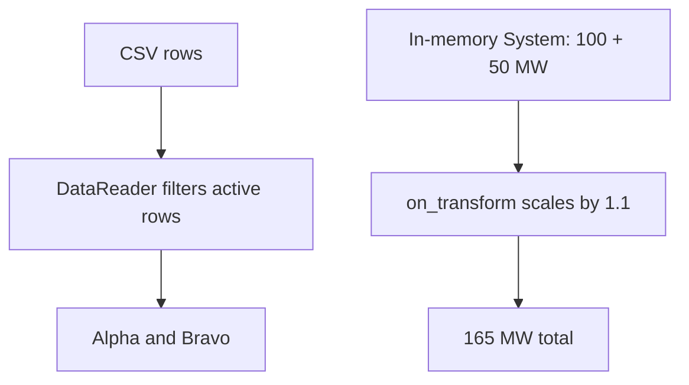

<span id="getting-started-with-r2x-core"></span>

Use the installed `r2x-core` package to read CSV data and scale a small system by 10%, verifying a 165 MW result.
The Python examples run as doctests. You do not need a repository checkout, external dataset, or CLI installation.



<span id="prerequisites"></span>

## Install r2x-core

Complete [Getting started: prerequisites and environment](/r2x-core/getting-started/environment/) first. Then choose the command for your environment.

For a project managed by uv, add `r2x-core` as a project dependency:

```bash
uv add r2x-core
```

For a standard Python environment, activate its virtual environment and install with pip:

```bash
python -m pip install r2x-core
```

Both commands install the released package and its runtime dependencies, including [infrasys](https://natlabrockies.github.io/infrasys/) for component storage and [Polars](https://docs.pola.rs/) for tabular input.

## Inspect the input and schema

Use these sample rows:

```csv
name,capacity_mw,status
Alpha,100,active
Bravo,50,active
Retired,25,retired
```

`Alpha` and `Bravo` contribute 150 MW before scaling.
The retired row must not appear in the result.
The `Generator` class below defines the small schema used in this exercise.
Each Python code block is tested as a doctest.

```python doctest
>>> from infrasys import Component
>>> from pydantic import Field
>>> class Generator(Component):
...     capacity_mw: float = Field(ge=0)
...
>>> generator = Generator(name="Alpha", capacity_mw=100)
>>> assert generator.capacity_mw >= 0
>>> generator.name, generator.capacity_mw
# ('Alpha', 100.0)
```

`Component` supplies identity and the required name. The field adds nonnegative capacity in MW.
This example defines a small schema. It is not a generator model provided by r2x-core.
For native model schemas and parsers, use packages such as [r2x-sienna](https://github.com/NatLabRockies/r2x-sienna) or [r2x-plexos](https://github.com/NatLabRockies/r2x-plexos).
For ReEDS inputs, start with [r2x-reeds](https://github.com/NatLabRockies/r2x-reeds).

<span id="working-with-data-files"></span>

## Understand the data boundary

A `DataStore` can hold named file definitions. This doctest writes a small CSV to a temporary directory and reads it through `DataReader`:

```python doctest
>>> from pathlib import Path
>>> from tempfile import TemporaryDirectory
>>> from r2x_core import DataFile, DataReader, TabularProcessing
>>> with TemporaryDirectory() as directory:
...     root = Path(directory)
...     _ = (root / "generators.csv").write_text("name,capacity_mw,status\nAlpha,100,active\nBravo,50,active\nRetired,25,retired\n", encoding="utf-8")
...     processing = TabularProcessing(steps=[{"op": "filter_columns", "filter_by": {"status": "active"}}])
...     sources = DataReader().read_data_files(
...         [DataFile(name="generators", relative_fpath="generators.csv", proc_spec=processing)],
...         folder_path=root,
...     )
...     rows = sources["generators"].data.collect().to_dicts()
...
>>> [row["name"] for row in rows]
# ['Alpha', 'Bravo']
```

`generators` is the logical source name. `relative_fpath` is resolved under the supplied input root. The filter runs while processing the source. `DataReader` reads typed sources, and `build_system` also uses the configured component instruction. Registering a file does not prove it can be read.
See [file configuration](/r2x-core/how-tos/configure-data-files/) for reader options and [data contracts](/r2x-core/references/data-workflow/) for return types and failure boundaries.

<span id="working-with-systems"></span>

<span id="plugin-configuration"></span>

<span id="creating-a-plugin"></span>

## Follow the three implemented hooks

The full example that reads files implements three lifecycle hooks. This doctest demonstrates `on_transform` with a `System` in memory:

| Hook | Work in the complete example | Observable check |
| --- | --- | --- |
| `on_build` | Read active rows and add two `Generator` components. | `Retired` is absent. |
| `on_transform` | Multiply each capacity by `BuildConfig.scale`, default `1.1`. | Capacities become 110 and 55 MW. |
| `on_export` | Save the system at `output/system.json`. | The entrypoint and companion directory exist. |

The transformation is deliberately small:

```python doctest
>>> from infrasys import Component
>>> from pydantic import Field
>>> from r2x_core import Plugin, PluginConfig, PluginContext, System
>>> from rust_ok import Ok, Result
>>> class Generator(Component):
...     capacity_mw: float = Field(ge=0)
...
>>> class ScaleConfig(PluginConfig):
...     scale: float = 1.1
...
>>> class Scale(Plugin[ScaleConfig]):
...     def on_transform(self) -> Result[System, str]:
...         for generator in self.system.get_components(Generator):
...             generator.capacity_mw *= self.config.scale
...         return Ok(self.system)
...
>>> system = System(name="scale-demo")
>>> system.add_component(Generator(name="Alpha", capacity_mw=100))
>>> system.add_component(Generator(name="Bravo", capacity_mw=50))
>>> result = Scale.from_context(PluginContext(config=ScaleConfig(), system=system)).run()
>>> assert result.system is not None
>>> round(sum(item.capacity_mw for item in result.system.get_components(Generator)), 1)
# 165.0
```

Returning `Ok(system)` updates the shared context with the transformed system.
[Lifecycle contracts](/r2x-core/references/plugins/) describe the complete hook order, context updates, and error propagation.

## Explore the complete example

The repository also contains a version that reads files, with mapping configuration, parser rules, an export, and a reload script. Browse the [CSV example source](https://github.com/NatLabRockies/r2x-core/tree/main/examples/csv-system) for those files. They are not included in the published `r2x-core` package and are not needed to run the examples on this page.

See [troubleshooting](/r2x-core/troubleshooting/) for file registration, lifecycle failures, and environment diagnosis.

<span id="working-with-rules"></span>

<span id="version-management"></span>

<span id="next-steps"></span>

## Continue with a real workflow

Use [data readers](/r2x-core/how-tos/read-data-files/) to handle your actual input format, then [define rule mappings](/r2x-core/how-tos/define-rule-mappings/) when converting between different component schemas.
Read [workflow boundaries](/r2x-core/explanations/workflow-boundaries/) before deciding which work belongs in core, a model package, R2X translation packages, or the CLI.
The [R2X workflow tutorials](https://natlabrockies.github.io/R2X/tutorials/getting-started/) show how those packages compose around real model formats.
