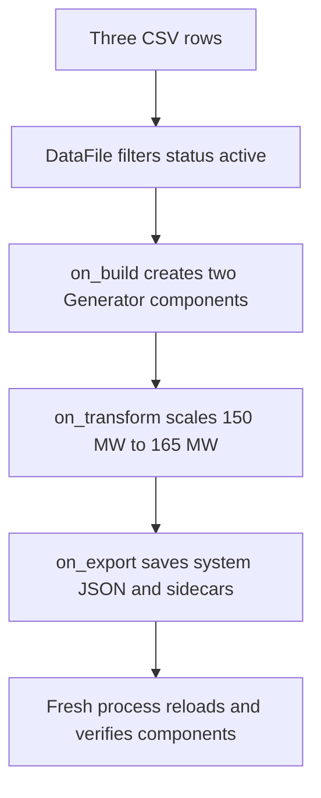

<span id="getting-started-with-r2x-core"></span>

Turn three CSV records into a saved, inspectable system with two active generators.
You will apply a 10% capacity increase, verify the resulting 165 MW total, and reload the artifact in a separate Python process.
The complete [worked example](https://github.com/NatLabRockies/r2x-core/tree/main/docs/examples/csv-system) is included in this repository; no external dataset or CLI installation is needed.



<span id="prerequisites"></span>

## Prepare the example

Complete [Getting started: prerequisites and environment](/r2x-core/getting-started/environment/) first.
This tutorial additionally needs Git to obtain its small CSV fixture and matching library source.
Use a new working directory, then obtain the example and the matching library source:

```bash
git clone --depth 1 https://github.com/NatLabRockies/r2x-core.git
```

Enter the checkout and install its locked runtime dependencies:

```bash
cd r2x-core
uv sync --locked --no-dev
```

This installs `r2x-core` from this checkout, including [infrasys](https://github.com/NatLabRockies/infrasys) for component storage and [Polars](https://docs.pola.rs/) for tabular input.
Move into the fixture directory so its relative input and output paths resolve correctly:

```bash
cd docs/examples/csv-system
```

`uv run --no-dev` below finds the project at the repository root.
You do not need to build the documentation site to run this example.

## Inspect the input and schema

Read the supplied fixture:

```bash
cat inputs/generators.csv
```

It contains:

```csv
name,capacity_mw,status
Alpha,100,active
Bravo,50,active
Retired,25,retired
```

`Alpha` and `Bravo` contribute 150 MW before scaling.
The retired row must not appear in the result.
`tutorial_model.py` defines the small schema used in this exercise:

The checks below are self-contained versions of the fixture's model, data and transform boundaries.
The documentation build also executes the complete fixture and its independent reload.

```python doctest
>>> from infrasys import Component
>>> from pydantic import Field
>>> class Generator(Component):
...     capacity_mw: float = Field(ge=0)
...
>>> generator = Generator(name="Alpha", capacity_mw=100)
>>> assert generator.capacity_mw >= 0
>>> # Expected: this boundary produces the tutorial's named components or capacity.
>>> generator.name, generator.capacity_mw
('Alpha', 100.0)
```

`Component` supplies identity and the required name; the field adds nonnegative capacity in MW.
This educational schema is defined by the example, not a built-in electrical generator model.
For native model schemas and parsers, use packages such as [r2x-sienna](https://github.com/NatLabRockies/r2x-sienna) or [r2x-plexos](https://github.com/NatLabRockies/r2x-plexos).
For ReEDS inputs, start with [r2x-reeds](https://github.com/NatLabRockies/r2x-reeds).

<span id="working-with-data-files"></span>

## Understand the data boundary

`build_system.py` creates an existing-directory `DataStore` and registers a named file definition:

```python doctest
>>> from pathlib import Path
>>> from tempfile import TemporaryDirectory
>>> from r2x_core import DataFile, DataStore, TabularProcessing
>>> with TemporaryDirectory() as directory:
...     root = Path(directory)
...     _ = (root / "generators.csv").write_text("name,capacity_mw,status\nAlpha,100,active\nBravo,50,active\nRetired,25,retired\n", encoding="utf-8")
...     store = DataStore(root)
...     processing = TabularProcessing(steps=[{"op": "filter_columns", "filter_by": {"status": "active"}}])
...     store.add_data([DataFile(name="generators", relative_fpath="generators.csv", proc_spec=processing)])
...     rows = store.read_data("generators").collect().to_dicts()
...
>>> # Expected: this boundary produces the tutorial's named components or capacity.
>>> [row["name"] for row in rows]
['Alpha', 'Bravo']
```

`generators` is the logical lookup name; `relative_fpath` is resolved under the store root.
The filter runs when the reader loads that data.
A CSV read returns a Polars lazy frame, so the build hook calls `collect()` before iterating rows.
Registration alone does not prove that an input is readable.
See [file configuration](/r2x-core/how-tos/configure-data-files/) for reader options and [data contracts](/r2x-core/references/data-workflow/) for return types and failure boundaries.

<span id="working-with-systems"></span>

<span id="plugin-configuration"></span>

<span id="creating-a-plugin"></span>

## Follow the three implemented hooks

The script binds `BuildConfig()` and the store to a `PluginContext`, then invokes `BuildScenario.from_context(context).run()`.
Only the hooks implemented by this plugin run:

| Hook | Work in this example | Observable check |
| --- | --- | --- |
| `on_build` | Read active rows and add two `Generator` components. | `Retired` is absent. |
| `on_transform` | Multiply each capacity by `BuildConfig.scale`, default `1.1`. | Capacities become 110 and 55 MW. |
| `on_export` | Save the system at `output/system.json`. | The entrypoint and companion directory exist. |

The transformation is deliberately small:

```python doctest
>>> from infrasys import Component
>>> from pydantic import Field
>>> from r2x_core import Plugin, PluginConfig, PluginContext, System
>>> from rust_ok import Ok, Result
>>> class Generator(Component):
...     capacity_mw: float = Field(ge=0)
...
>>> class ScaleConfig(PluginConfig):
...     scale: float = 1.1
...
>>> class Scale(Plugin[ScaleConfig]):
...     def on_transform(self) -> Result[System, str]:
...         for generator in self.system.get_components(Generator):
...             generator.capacity_mw *= self.config.scale
...         return Ok(self.system)
...
>>> system = System(name="scale-demo")
>>> system.add_component(Generator(name="Alpha", capacity_mw=100))
>>> system.add_component(Generator(name="Bravo", capacity_mw=50))
>>> result = Scale.from_context(PluginContext(config=ScaleConfig(), system=system)).run()
>>> assert result.system is not None
>>> # Expected: this boundary produces the tutorial's named components or capacity.
>>> round(sum(item.capacity_mw for item in result.system.get_components(Generator)), 1)
165.0
```

`self.system` is the system created by `on_build`; `Ok(system)` updates the shared context.
The output hook explicitly uses `overwrite=True` for this tutorial's fixed output path.
Each rerun rebuilds from the original CSV, so it does not apply the 10% increase repeatedly to an already scaled artifact.
[Lifecycle contracts](/r2x-core/references/plugins/) describe the complete hook order, context updates, and error propagation.

## Execute and verify the in-memory result

Run the supplied script:

```bash
uv run --no-dev python build_system.py
```

Expect these lines:

```text
2 active generators
165.0 MW after scaling
Saved output/system.json
```

The script asserts the component count before printing.
Check that the saved entrypoint and companion storage directory are present:

```bash
ls output
```

Expect `system.json` and `system_time_series/`.
Keep them together when copying the artifact, even though this fixture has no attached time-series values.
The JSON is an infrasys-compatible system artifact, not a native Sienna or PLEXOS export.
A native export requires the relevant model package's exporter.

## Verify a fresh-process reload

Run the independent inspection script:

```bash
uv run --no-dev python inspect_system.py
```

Expect:

```text
Alpha: 110.0 MW
Bravo: 55.0 MW
```

The script calls `System.from_json("output/system.json")`, queries `Generator` components, and asserts both names and the 165 MW total.
This checks the saved result rather than only the object left in memory by the build script.
The loader must be able to import `tutorial_model.Generator`; running from the fixture directory keeps that model module importable.
For CLI-managed inspection of an installed model package, follow [the CLI artifact guide](https://github.com/NatLabRockies/r2x-cli/blob/main/docs/inspect-artifacts.md).

## Diagnose a failed check

| Symptom | Check and fix |
| --- | --- |
| `Path does not exist: inputs` | Run from `docs/examples/csv-system`, where `inputs/` exists. |
| A negative capacity raises validation errors | Correct the CSV; the model rejects values below zero. |
| Reload cannot import `tutorial_model` | Use the fixture directory, or install your own model package into the loading environment. |
| JSON exists but companion storage is missing | Copy the whole output bundle, then rerun inspection. |

See [troubleshooting](/r2x-core/troubleshooting/) for file registration, lifecycle failures, and environment diagnosis.

<span id="working-with-rules"></span>

<span id="version-management"></span>

<span id="next-steps"></span>

## Continue with a real workflow

Use [data readers](/r2x-core/how-tos/read-data-files/) to handle your actual input format, then [define rule mappings](/r2x-core/how-tos/define-rule-mappings/) when converting between different component schemas.
Read [workflow boundaries](/r2x-core/explanations/workflow-boundaries/) before deciding which work belongs in core, a model package, R2X translation packages, or the CLI.
The [R2X workflow tutorials](https://natlabrockies.github.io/R2X/tutorials/getting-started/) show how those packages compose around real model formats.
