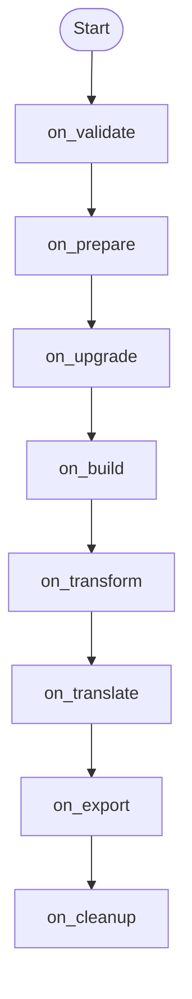

<span id="plugin-system"></span>

Build a small plugin that creates a system and then transforms it.
The example uses only public `config` and `system` properties; the context is
bound through `from_context()`. No ReEDS inputs or external model package is needed.
Complete [installation](/r2x-core/install/) first.

The lifecycle visits implemented hooks in this order; missing hooks are skipped.



## Create and transform a system

`on_build()` returns the system placed into the context. `on_transform()` can
then use that system. A hook returning `Err` stops the lifecycle with `PluginError`.
The comments explain expected values; the following output and assertions check them.

```python doctest
>>> from r2x_core import Plugin, PluginConfig, PluginContext, PluginError, System
>>> from rust_ok import Err, Ok, Result
>>> class BuildConfig(PluginConfig):
...     system_name: str = "capacity-demo"
>>> class BuildDemo(Plugin[BuildConfig]):
...     def on_validate(self) -> Result[None, str]:
...         if not self.config.system_name.strip():
...             return Err("system_name must not be blank")
...         return Ok(None)
...     def on_build(self) -> Result[System, str]:
...         return Ok(System(name=self.config.system_name))
...     def on_transform(self) -> Result[System, str]:
...         self.system.name += "-ready"
...         return Ok(self.system)
>>> context = PluginContext(config=BuildConfig())
>>> result = BuildDemo.from_context(context).run()
>>> # Expected: the build hook ran before the transform hook.
>>> result.system.name
# 'capacity-demo-ready'
>>> assert result is context
>>> # Expected: an invalid name is rejected before a system is built.
>>> invalid = PluginContext(config=BuildConfig(system_name=" "))
>>> try:
...     BuildDemo.from_context(invalid).run()
... except PluginError as error:
...     assert "system_name must not be blank" in str(error)
...     print(type(error).__name__)
# PluginError
>>> assert invalid.system is None
```

## Connect real data

A real parser needs input definitions and component validation, not a placeholder
build method. [Build a parser](/r2x-core/how-tos/build-parsers/) creates and reads
its own CSV fixture and verifies the resulting component.
The [capacity scenario](/r2x-core/tutorials/getting-started/) adds typed capacity,
filtering, scaling, persistence and an independent reload.

## Understand failure boundaries

Only implemented hooks run. The full order and updated context fields are in
[Plugin lifecycle](/r2x-core/references/plugins/).
Earlier hooks may mutate state or write files before a later hook fails; execution
is not transactional. Start a retry from a fresh context unless the plugin
explicitly supports resuming partially completed work.

Use [function plugins](/r2x-core/how-tos/create-function-plugins/) for a transform
that does not need a class lifecycle. For installed execution and discovery,
use the separate [r2x-cli Getting Started guide](https://github.com/NatLabRockies/r2x-cli/blob/main/docs/getting-started.md#validate-and-run-a-pipeline).

<span id="creating-a-simple-plugin"></span>

<span id="plugin-lifecycle"></span>

<span id="complete-lifecycle-example"></span>

<span id="required-vs-optional-context-fields"></span>

<span id="example-parser-requires-config-store"></span>

<span id="example-exporter-requires-config-system-store"></span>

<span id="plugin-capabilities-inferred-from-hooks"></span>

<span id="example-multi-capability-plugin"></span>

<span id="configuration-with-type-safety"></span>

<span id="plugin-discovery"></span>

<span id="passing-context-through-pipelines"></span>

<span id="error-handling"></span>

<span id="introspection-for-plugin-discovery"></span>

<span id="best-practices"></span>

<span id="function-based-transform-plugins"></span>

<span id="next-steps"></span>
